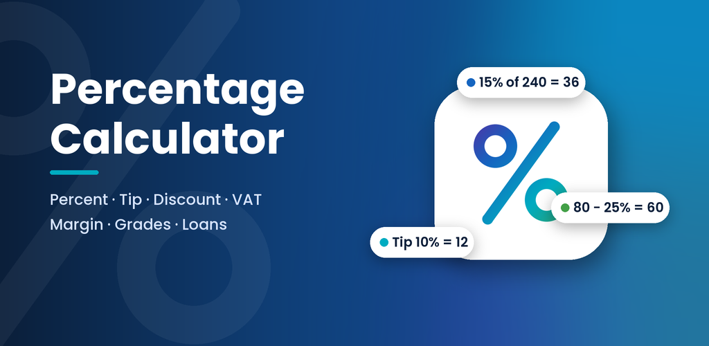
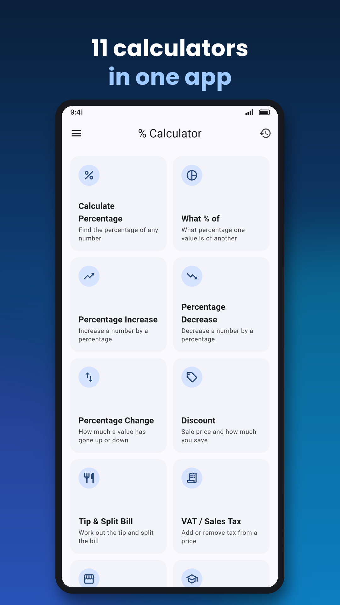
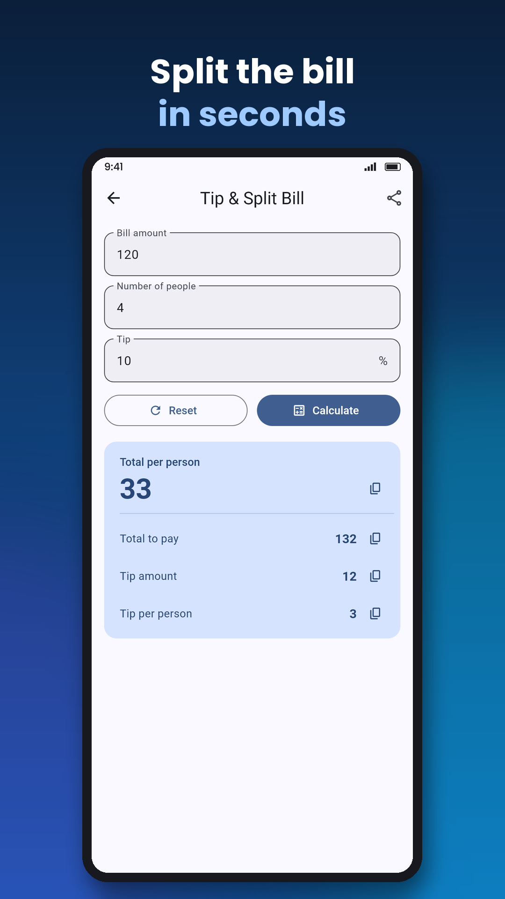
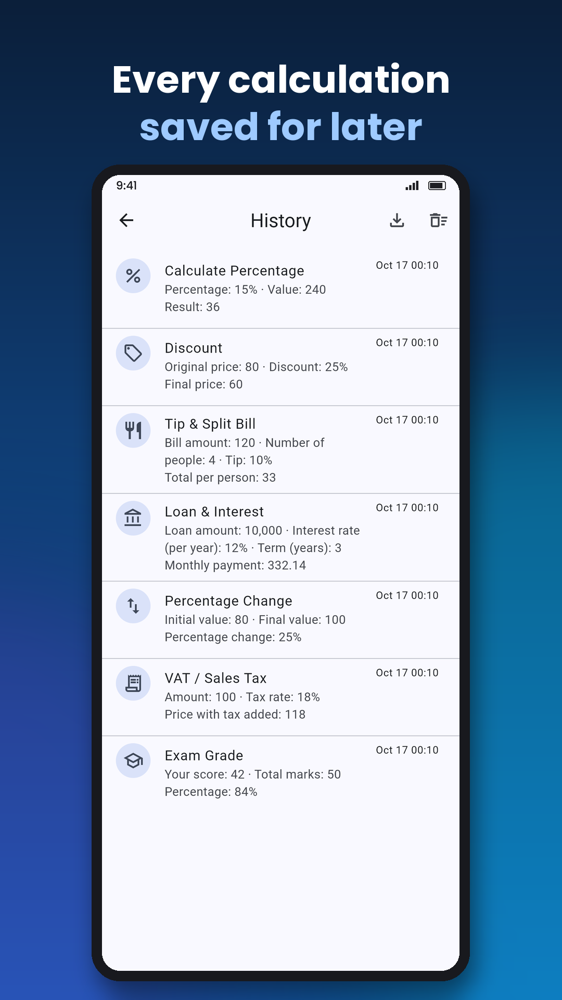
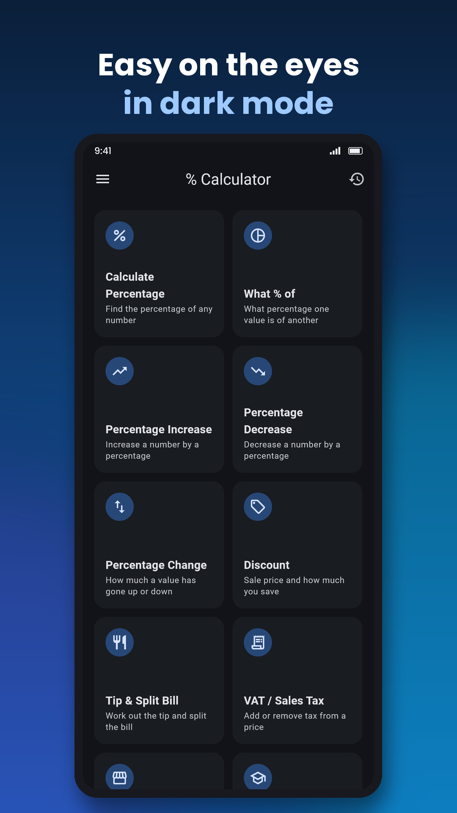

# Percentage Calculator



Fast, free percentage maths for Android (Flutter): 11 calculators, results as
you type, history with CSV export, a home-screen widget, 7 languages, and an
optional AI assistant.

**Google Play:** `com.techoveride.percentagecalculator` ·
**Privacy policy:** https://techoveridehub.com/percal-privacy-policy/ ·
**Release notes:** [RELEASE_NOTES.md](RELEASE_NOTES.md)

| Home | Tip & split | History | Dark mode |
|---|---|---|---|
|  |  |  |  |

## Features

- **Calculators:** percentage, what % of, increase, decrease, percentage change,
  discount, tip & split bill, VAT / sales tax, profit margin, exam grade, loan &
  interest (EMI). Exact maths in `lib/util/calculations.dart`.
- **History:** saved automatically, reopen, swipe to delete, export as CSV.
- **AI assistant:** ask about your history, type a calculation in words, Explain
  any result, Insights. Gemini through Firebase AI Logic (free tier); the AI
  never does arithmetic — numbers always come from the app's calculators.
- **Home-screen widget** and long-press shortcuts (`percal://` links).
- **Material 3**, light/dark mode, accent colours; English, French, Swahili,
  Hindi, Spanish, Portuguese and Arabic (`lib/l10n/*.arb`).
- **Monetisation:** AdMob banner, app open and rewarded ads with Google's
  consent form; one-time `remove_ads` purchase.
- **Firebase:** Analytics, Crashlytics, Remote Config (update prompts and AI
  switches), App Check.

## Project layout

| Path | What |
|---|---|
| `lib/` | Flutter app (`model/` calculators, `ai/`, `ads/`, `history/`, `premium/`, `launch/` widget & shortcuts, `remote/`) |
| `android/` | Android project, widget provider (Kotlin) |
| `test/` | Unit and widget tests; `store_screenshots_test.dart` renders the store images |
| `firebase/` | Remote Config template (`firebase deploy --only remoteconfig`) |
| `server/ai-worker/` | Optional Claude backend on Cloudflare Workers (paid upgrade) |
| `website/` | WordPress privacy page template and `app-ads.txt` |
| `design/` | Splash options, feature graphic, store screenshots and generators |
| `docs/AI_SETUP.md` | Turning the AI assistant on |

## Build

Requires Flutter 3.47+ (Dart 3.13).

```bash
flutter pub get
flutter test
flutter build appbundle --release
```

Release signing reads `android/key.properties` (not in git):

```properties
storePassword=...
keyPassword=...
keyAlias=upload
storeFile=upload-keystore.jks   # relative to android/app
```

Without it, release builds fall back to the debug key (not uploadable to Play).
Bump `version:` in `pubspec.yaml` (`name+build`) for every Play upload.

## Configuration

- **Remote Config** (`lib/remote/remote_settings.dart`): `min_version_code`,
  `latest_version_code`, `update_message`, `update_url`, `ai_enabled`,
  `ai_provider`, `ai_model`, `ai_endpoint`.
- **AdMob IDs:** `lib/ads/ad_config.dart` and `android/app/src/main/AndroidManifest.xml`.
  Debug builds always use Google's test ads.
- **Firebase:** project `percalculator` (`lib/firebase_options.dart`,
  `android/app/google-services.json`).

© Techoveride · techoveridehub@gmail.com
